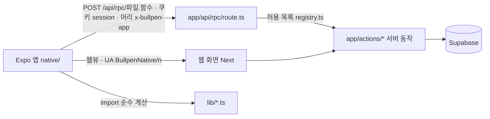

# 1. 전체 시스템 아키텍처 (v1 · 2026-10-18 — 1-6 Expo 앱 더함)

## 1-1. 기술 스택

| 층 | 무엇 | 비고 |
|---|---|---|
| 웹 | Next.js 16.3.6 App Router · React 19.2 · Tailwind 4 | 서버 컴포넌트 + 서버 동작(actions) 위주, API 경로는 파일 올리기 · 앱 · 큰 본문용 |
| DB | Supabase Postgres + Prisma 7.9(adapter-pg, 풀 20 · 풀러 6543) | **개발 DB = 운영 DB**, `relationMode = "prisma"`(DB 외래키 없음), 마이그레이션 89개 |
| 파일 | Supabase Storage 비공개 버킷 `pitch-videos` 하나 | 서명 주소로 올리고 받음(`lib/storage.ts`) |
| 인증 | 자체 JWT(jose) 쿠키 + bcrypt, `lib/dal.ts` | 미들웨어 없음 — 쪽 · 동작마다 `getCurrentUser`/`requireUser` |
| 앱(옛) | Capacitor iOS 껍데기(`mobile/`) | **원격 사이트를 띄운다**(`bullpen-log.vercel.app/today`), UA `BullpenLogApp`, 네이티브 부품 넷 |
| 앱(새) | Expo 58 · React Native 0.88(`native/`, 약 3만 줄, 김민 영역) | 옮긴 화면은 네이티브, 나머지는 웹뷰. 서버는 `/api/rpc` 로 서버 동작을 부름 — 1-6 |
| GPU | Modal(`services/pitch3d-gpu`) — RTMW 2D + node 로 TS 엔진 실행 | 3D 동작 분석 전용, 웹과는 HTTP + 서명 주소 |
| 배포 | Vercel `icn1`(서울), `npm run build` 가 `prisma migrate deploy` 포함 | main 에 올리면 운영 DB 에 마이그레이션 |
| 시험 | npm 스크립트 · 순수 노드 셀프테스트 약 30개 | 테스트 프레임워크 · CI 시험 없음. 일부는 운영 DB 읽기 |

## 1-2. 폴더

```
app/
  (app)/            탭 화면(공용 틀 layout.tsx + 병렬 경로 @home @videos @training @nutrition @modal — 탭 넷이 늘 떠 있음)
    today/ videos/ training/ nutrition/ pitch-log/ coach/ library/ profile/ admin/ board/
  (session)/        전체 화면 흐름: workout · armcare · mechanics · checkin · velocity · admin/shoot run
  (legal)/          약관 · 처리방침
  actions/          서버 동작 33파일(카테고리별)
  actions/app*.ts    앱 전용 얇은 껍데기(웹 로더를 감싸 JSON 으로) 11파일
  api/              day-detail · library · nutrition · pitch-lab · pitch-log · profile · session · sim-offset · rpc(앱 입구)
  login/            가입 · 로그인
components/         공용 UI(ui.tsx · icon.tsx · app-shell.tsx …) + 카테고리 하위 폴더
lib/                도메인 로직(순수 함수 다수) — 아래 1-3
prisma/             schema.prisma(1,619줄 · 44모델) · migrations/
scripts/            셀프테스트 · 백업 · 패치노트 · 실험 도구
services/pitch3d-gpu/  Modal 파이썬 + 묶은 TS 엔진(engine/ 는 .gitignore)
mobile/             Capacitor iOS · Swift 부품(옛 앱, 새 앱이 나갈 때까지)
native/             Expo 앱 — src/app(화면) · src/lib(rpc · 대기열) · modules/(Swift 카메라 부품)
docs/               설계(designs/) · 이 문서(architecture/) · Claude 메모(claude/)
```

## 1-3. 카테고리와 주인 모듈

| 카테고리 | 화면 | 서버 동작 · API | 핵심 lib | 소유 모델 |
|---|---|---|---|---|
| 계정 · 프로필 · 잠금 | login · profile · 설정 · 튜토리얼 | auth · profile · onboarding-state · pitch-setup · training-setup | dal · profile · feature-locks · baseline · nav | User |
| 체크인 | (session)/checkin · checkin-gate · 탭 카드 셋 | checkin · day-cards | checkin · body-spots · checkin-flow-load | DailyCheckin |
| 투구 기록 | videos · pitch-log/[date] · @modal | api/pitch-log/* · featured-video · calendar-event | pitch-stats · pitch-effort · pitch-satisfaction · report/arm-status | PitchLog · DailyFeaturedVideo · CalendarEvent |
| 구속 측정 | (session)/velocity · admin/velocity | velocity · velocity-admin · velocity-recording | velocity-* · velocity-engine/* | Velocity* (7표) |
| 3D 동작 분석 | videos/lab | pitch-lab · api/pitch-lab | pitch-lab* · pitch-3d/** + Modal | (DB 없음 — 저장소 JSON) |
| 트레이닝 | training · (session)/workout | training-setup · workout · program · plan-edit · exercise-log | report/* · engine/* · program/* · workout/* | DailyTrainingSetup · TrainingSession · UserExerciseSet · UserExerciseLog · DailyTrainingNote · UserTrainingProgram |
| 암케어 · 재활 | training 안 · (session)/armcare | armcare · rehab | armcare/* | DailyArmcare · UserArmcareRoutine · UserRehab* |
| 메커니즘 | training 안 · (session)/mechanics · library/mechanics | mechanics | mechanics/* | MechanicsProgram · UserDrillLog |
| 영양 | nutrition · nutrition/setup | nutrition · api/nutrition/* | nutrition/* | NutritionProfile · MealEntry · UserFood · MealCombo · MealPlan · DailyNutrition |
| 홈 · 분석 | today · coach | api/day-detail | day-detail · report/highlights* · report/today-data · today/history | (읽기만) |
| 라이브러리 · 촬영 | library · admin/shoot | content · warmup · shoot · favorite · exercise-note | library-cache · shoot/* · clip/* | ExerciseVideo · MechanicsGuide · WarmupRoutine* · ShootCheck · 즐겨찾기 · 메모 |

**두 사람 나눔**(메모 기준): 금윤호 = 트레이닝 · 구속 측정 · 3D 엔진 · 홈 · 영양 일부, 김민 = 투구 · 기록 · 인터페이스(앱 틀). 실제로는 둘 다 거의 모든 곳을 고친다(지난 30일 상위 15파일 모두 두 사람 손).

## 1-4. 공용 부품(바꾸면 넓게 깨지는 것)

| 파일 | 하는 일 | 부르는 곳 | 바꿀 때 |
|---|---|---|---|
| `lib/dal.ts` | 세션 → 사용자(약 30칸 select) | 93 | select 칸을 바꾸면 feature-locks · 모든 쪽 |
| `lib/prisma.ts` | DB 풀 · 시험 계정 시각 덮기(`TIME_FIELDS`) | 95 | 새 `@default(now())` 칸은 `TIME_FIELDS` 에 |
| `lib/clock.ts` · `clock-server.ts` | `appNow()`(시험 계정 날짜) | 55 | Next 내부 import 를 씀(깨지기 쉬움) |
| `lib/pitch-stats.ts` | `toDateKey` · `shiftDateKey` · 강도 변환 | 다수 | 날짜 키 기준 |
| `lib/checkin.ts` | 체크인 읽기 규칙 · 문턱(`LOW_CONDITION_THRESHOLD`) | 엔진 · 영양 · 암케어 | 1,000줄 넘음, 옛 칸 읽기가 섞임 |
| `lib/report/gather.ts` | 45일 기록 → facts(엔진 입구) | 트레이닝 · 홈 · 암케어 · 프로그램 · 메커니즘 · 투구 탭 | 모든 추천의 입력 |
| `lib/feature-locks.ts` · `lib/nav.ts` | 탭 잠금 · 메뉴 | 27 · 6 | |
| `lib/storage.ts` | 버킷 · 서명 · 지우기 | 37 | 사용자 파일 경로 규칙 |
| `lib/library-cache.ts` | 운동 · 드릴 캐시(이름에 판 번호, 손으로 올림) | 35 | 스크립트로 DB 를 고치면 판 번호 올리기 |
| `components/ui.tsx` · `icon.tsx` | 공용 UI · 아이콘(150종) | 78 · 161 | |
| `components/app-shell.tsx` | 앱 틀(3,120줄) | 레이아웃 | 두 사람이 자주 겹침 |
| `app/globals.css` | 토큰 · 반응형 조건(`desk` · `pad`) | 전체 | 두 사람이 자주 겹침 |

## 1-5. 구현 상태 요약

**됨**: 가입 4화면 + 탭별 첫 설정 · 체크인 3판(신호 셋 + 탭 카드 셋) · 투구 기록(% 강도 · 만족도 · 영상) · 구속 엔진 2.5.2(앱 카메라 · 시도 기록 ·
관리자 탐색기 · 녹화 편집기) · 3D v2(Modal · 데생 인형 · 메커니즘 점검 · 비용 가드, 10-14 일반 공개) · 트레이닝 추천 2판 P0~P6 + Y ·
근력 · 파워 프로그램 7+2 · 암케어 · 재활 · 메커니즘 프로그램 · 영양(목표 · 조언 · 식단 짜기 · 조합 · 바코드 · 식약처) · 홈 피드 · 분석 둘 · 촬영 관리자 · 앱 틀(탭 판 넘기기).

**안 됨 · 대기**: Modal 재배포(footFlat · 어깨 바로잡기 · framing) · PitchLog 색인 · 영양 2차(당류 · 나트륨) · 끼니 알림(앱) · 성장기 메커니즘
'그래도 하기' 사용자 확인 · 실기기 확인 다수(체크인 흐름 · 가입 · 탭 판 · 구속 카메라) · 시험 DB(개발 = 운영) · 큰 파일 나누기 · 옛 체크인 칸 정리.

## 1-6. 아이폰 앱 두 개와 서버 입구(2026-10-18 더함)



- **서버 동작 한 벌을 웹 · 앱이 같이 쓴다.** 앱 전용 `app/actions/app*.ts` 는 웹 로더를 감싸 JSON 으로 돌려주는 껍데기(대부분 30~60줄, DB 를 직접
  읽는 것은 관리자 · 홈 둘). 로그인 확인은 동작마다 그대로(통합 시험 [7] — 2026-10-18 부터 파일 안 도우미 · 한 단계 위임을 따라감).
- **판 번호가 둘이다.** 헷갈리기 쉬우니 구분한다.

  | 번호 | 어디 | 뜻 | 올리는 때 |
  |---|---|---|---|
  | `APP_API_LEVEL` · `MIN_APP_API` | `lib/app-api.ts` | 서버 동작의 인자 · 답 모양 약속. 낮으면 `/api/rpc` 가 426 | 앱이 부르는 동작 모양을 깔린 앱이 못 알아듣게 바꿀 때 |
  | `BullpenNative/<n>` | `native/src/lib/site.ts` APP_UA ↔ `lib/app-env.ts` | 앱이 아는 네이티브 화면 판. 사이트가 앱 화면으로 넘기기 전에 봄 | 앱에 화면을 옮겨 넣을 때 |

- **모양 기록**: 앱이 부르는 서버 동작 154개의 인자 · 답 모양을 `scripts/native-api-shapes.json` 에 적어 두고 `npm run native-api:test` 가 견준다
  (바뀌면 실패 → 앱을 맞추고 `-- --update`, 깔린 앱이 깨지면 `APP_API_LEVEL`). 앱 코드의 `rpc<T>()` 는 답 모양을 손으로 적어 앱 타입 검사로는 못 잡기 때문.
- **공용 계산 경계**: 앱은 `@/lib/…` 순수 파일을 그대로 쓴다. 서버 · 브라우저 전용이 섞이면 `npm run shared-lib:test` 가 잡는다.
- **아직 없는 것**: 앱 업데이트 장치(`expo-updates` — 지금은 화면을 고쳐도 빌드 + 심사), 데스크톱의 앱 타입 · 린트 검사(`native/node_modules` 없음).
