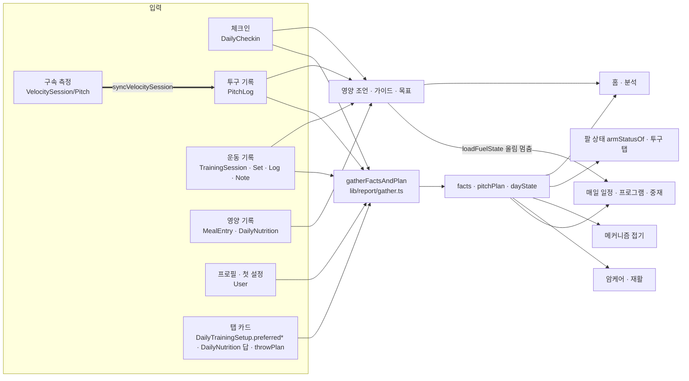
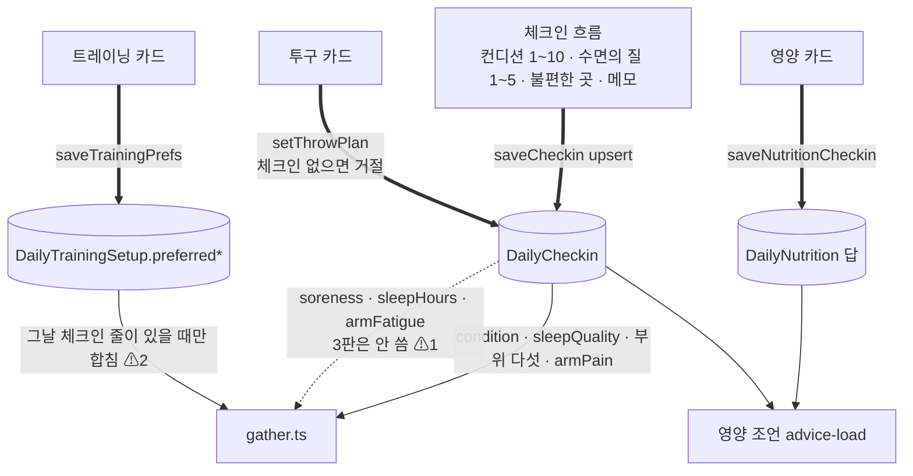
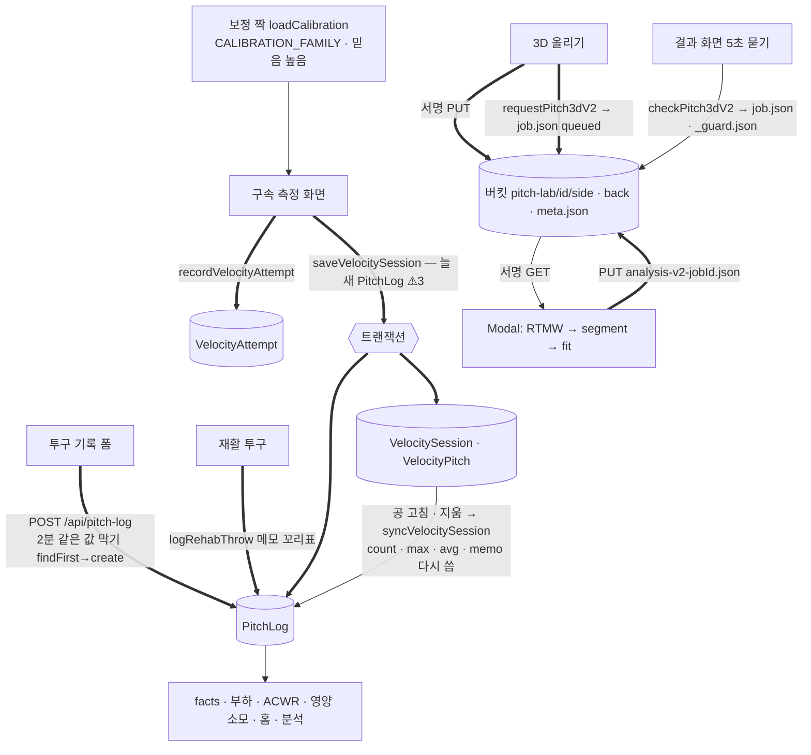
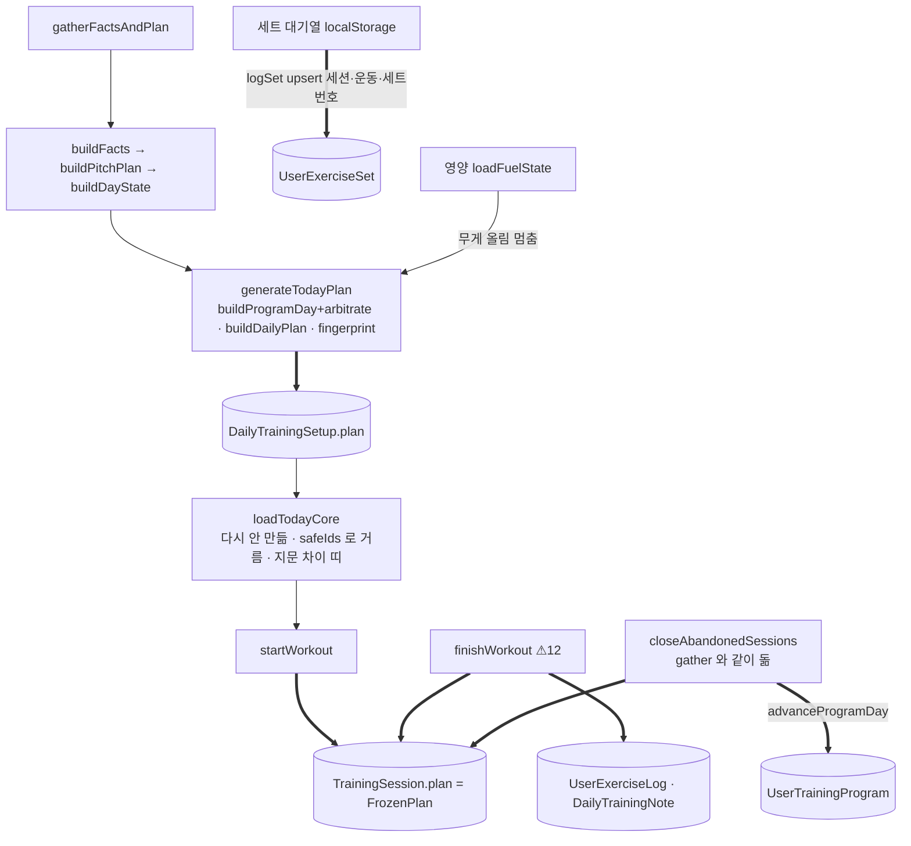
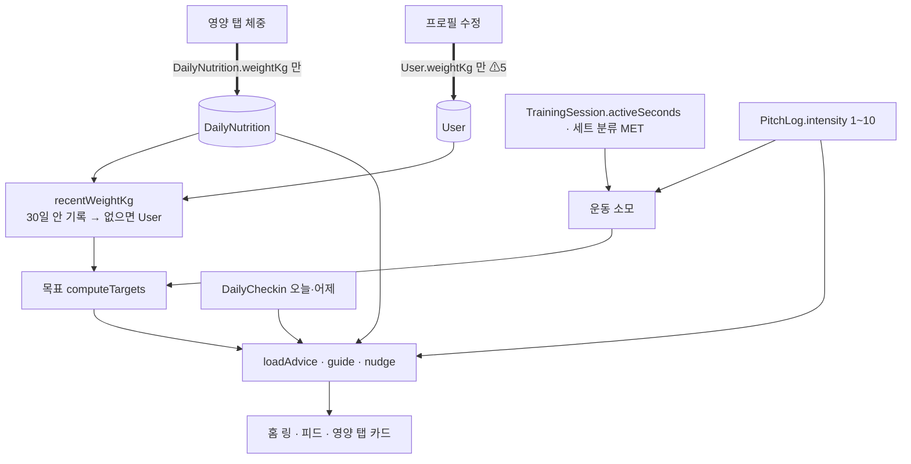

# 2. 카테고리별 데이터 흐름도 (초안 v0 · 2026-10-16)

굵은 화살표 = 쓰기, 가는 화살표 = 읽기. ⚠ 는 [README](README.md) 위험 번호.

## 2-0. 전체 — 누가 누구를 읽나

## 2-1. 체크인 3판 → 엔진

## 2-2. 투구 · 구속 · 3D

## 2-3. 트레이닝 하루

## 2-4. 영양 하루

## 2-5. 홈

홈은 쓰지 않고 읽기만 한다: `loadTodayCoreCached`(트레이닝) · `loadHighlights`(PitchLog.maxVelocity · 수면의 질 · 운동) · `loadAdvice`(영양) ·
`loadPitchHistory`(달력) · `loadDayDetail`(그날 칸, `/api/day-detail` 로 클립까지). 홈 링 · 달력 · 트레이닝 화면이 같은 하루의 운동 수를 각자 센다
(달력 = 저장된 `picks.length`, 홈 = 거른 `shownPicks`, 트레이닝 = `trainingScreenOf` 규칙) — 프로그램 날 · 묵은 일정에서 어긋날 수 있다(◻).
