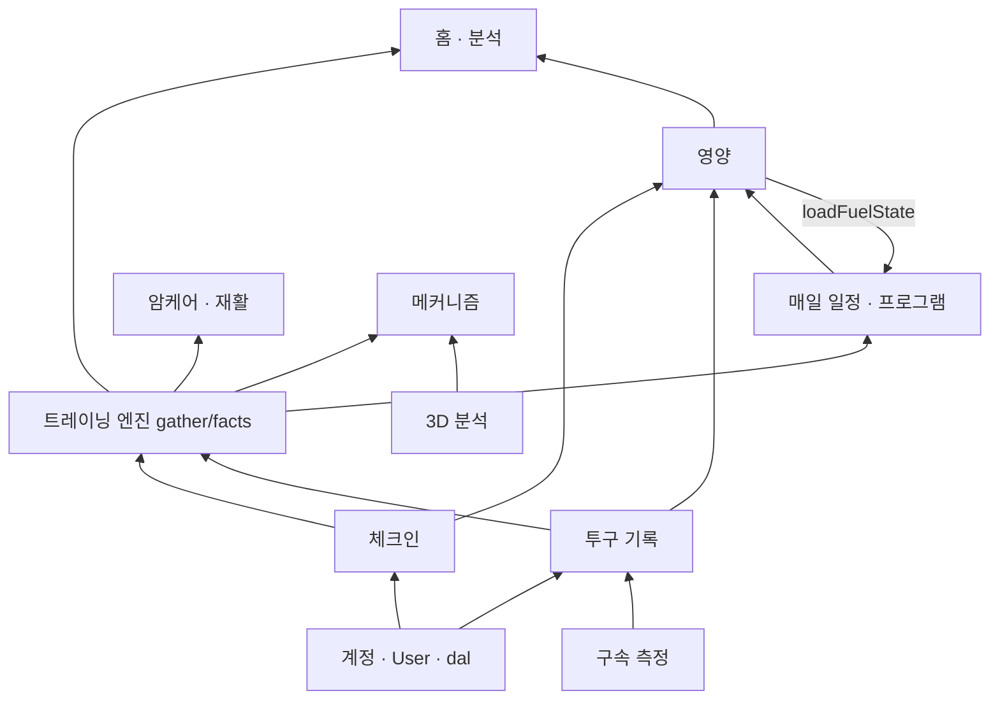

# 5. 기능 의존성 · 개발 순서 (초안 v0 · 2026-10-16)

## 5-1. 의존 그래프

영양 ↔ 트레이닝은 서로 읽는다(소모 ↔ 무게 올림 멈춤). 지금은 한쪽이 상대 결과를 '읽기만' 해서 고리가 실행 고리는 아니다 — 영양 계산이 트레이닝 계획을 부르기 시작하면 고리가 된다(금지).

**바꾸면 넓게 번지는 순서**: `lib/dal.ts` > `lib/checkin.ts` · `lib/report/gather.ts` · `facts.ts` > `lib/pitch-stats.ts` > `lib/storage.ts` > 카테고리 안쪽.

## 5-2. 공통 파일 관리 규칙(제안 — 승인되면 AGENTS.md 에 옮김)

**공통 파일**: `prisma/schema.prisma` · `lib/dal.ts` · `lib/prisma.ts` · `lib/clock*.ts` · `lib/checkin.ts` · `lib/report/gather.ts` · `lib/report/facts.ts` · `lib/pitch-stats.ts` ·
`lib/feature-locks.ts` · `lib/nav.ts` · `lib/storage.ts` · `lib/library-cache.ts` · `components/app-shell.tsx` · `components/ui.tsx` · `components/icon.tsx` · `app/globals.css` ·
`app/(app)/layout.tsx` · `package.json` · `HANDOFF.md`.

1. 기능 세션은 공통 파일을 **고치기 전에** 이 통합 세션에 무엇을 왜 바꾸는지 알린다(또는 사용자에게 "통합 검토 받기"). 더하기(새 export · 선택 칸)는 알림만, 이름 바꾸기 · 지우기 · 뜻 바꾸기는 검토 뒤.
2. 한 공통 파일은 한 번에 한 세션만 고친다 — 시작할 때 `git pull`, 끝나면 바로 커밋 · 올리기(오래 쥐지 않음).
3. 남의 카테고리 표를 Prisma 로 직접 읽지 말고 그 카테고리의 제공 함수를 쓴다([04](04-interfaces.md)). 없으면 제공 함수를 더해 달라고 요청.
4. DB 구조는 AGENTS 2번 그대로(한 명씩 · 백업 · 더하기만 안전). 칸 지우기는 2단계(코드에서 안 읽게 → 배포 → 칸 지우기).
5. 변경 뒤 [06](06-integration-tests.md) 의 해당 시험을 돌린다. 운영 DB 를 쓰는 시험은 읽기만.

## 5-3. 개발 순서(제안)

| 단계 | 내용 | 막는 것 | 의존 | 크기(Claude 기준) |
|---|---|---|---|---|
| 0 | 이 문서 승인 · 사용자 결정 D1~D5 | 모든 고침의 방향 | — | 사용자 몫 |
| 1 | **안전 규칙 복구**: 체크인 3판 옛 칸 정리(D1 대로 — 저장 때 옛 칸 null + 읽는 10여 곳 정리) · 카드 답을 체크인과 따로 합치기(⚠2) | P0 ⚠1 ⚠2 | D1 | 2~3시간 |
| 2 | **이중 계산 · 중복 막기**: 구속 세션 ↔ 손 기록(D2) · 구속 저장 멱등 키 · `finishWorkout` 상태 조건 · 투구 POST 경합 | P0 ⚠3 · ⚠12 | D2 · (DB 칸이면 단계 5와 묶음) | 2~3시간 |
| 3 | **공통 헬퍼 한 곳**: `lib/date-key.ts`(⚠13) · `getBodyWeight`(⚠5, D5) · 나이 띠 표(D3) · `requireAdmin` 하나로(⚠16) · 컨디션 4(D4) | P1 다수 | D3~D5 | 3~4시간 |
| 4 | **무효화 표 · 잠금 서버 확인**(⚠10 ⚠11) · 프로그램 날 오늘 장비(⚠9) | P1 | 1 | 1~2시간 |
| 5 | **DB 더하기**(백업 · 김민 알림): PitchLog `[userId,date]` · UserExerciseLog `[userId,date]`(HANDOFF 대기 그대로) · 외래키 색인 · (D2 가 칸을 원하면 그 칸) | ⚠18 | 김민과 순서 | 1시간 + 사용자 확인 |
| 6 | **3D 판 번호**: 가드를 `build.json` 해시로 · Modal 재배포 · `meta.lens` | ⚠6 | Modal 배포 권한 | 1시간 |
| 7 | **통합 시험 틀**([06](06-integration-tests.md) T1~T8) — 1~4 의 회귀를 붙잡음 | ⚠4 | 1~4 와 같이 | 3~4시간 |
| 8 | P2 정리: 오프라인 약속 하나 · 네이티브 판 번호 · 탈퇴 정리 · 죽은 칸 2단계 · 큰 파일 나누기 | P2 | 7 | 나눠서 |

**1 · 2 가 먼저인 까닭**: 지금도 쌓이는 데이터가 틀리거나(이중 계산) 안전 규칙이 꺼져 있다. 3 이후는 맞는 값을 덜 깨지게 만드는 일이다.
**7 을 1~4 와 같이**: 고친 것마다 그 자리에 시험을 박아 둬야 다른 세션이 되돌리지 않는다.

## 5-4. 기능 세션에 줄 작업 규칙(요약)

- 시작: `git pull` → `HANDOFF.md` → 이 폴더 README 의 위험 목록에서 내 카테고리 줄 확인.
- 남의 데이터는 [04](04-interfaces.md) 제공 함수로. 강도는 `effortPctOf`, 날짜는 `todayKey`/`keyOfDbDate`/`dbDateOf`(만들어진 뒤), 체중은 `getBodyWeight`(만들어진 뒤).
- 쓰기 동작을 새로 만들면: 소유 확인 · 잠금 확인 · 멱등(같은 요청 두 번) · 무효화 표 한 줄.
- 끝: 해당 셀프테스트 + 통합 시험 · `npx tsc --noEmit` · 바꾼 파일 eslint · 공통 파일을 건드렸으면 HANDOFF 한 줄.

## 5-5. 큰 파일 나누기 계획(2026-10-16 — 아직 안 나눔, 시점을 맞춘 뒤)

두 파일이 여러 세션 · 두 사람의 합치기 충돌을 가장 많이 낸다(지난 3일 커밋: 앱 틀 58번 · 구속 측정 화면 27번). 나누기는 **동작을 바꾸지 않는 옮기기**만 한다.

| 파일 | 지금 | 나누는 법 | 어려움 · 시간(Claude) | 언제 |
|---|---|---|---|---|
| `components/app-shell.tsx` | 3,129줄 — 이미 함수로 나뉨: AppNav 1,247 · DetailMenu 504 · MobileTabs 345 · MobileTopBar 160 · DockGrid 126 · QuickBar 97 · 작은 아이콘들 | `components/app-shell/` 폴더로 함수째 옮김: `mobile-tabs.tsx`(MobileTabs · TabFace) · `mobile-top-bar.tsx`(MobileTopBar · useBarHidden) · `detail-menu.tsx` · `dock.tsx`(DockGrid · QuickBar · Squares · MenuSquares) · `parts.tsx`(TopIcon · SettingsCog · Avatar · Tip · NavGlyph). `app-shell.tsx` 는 AppNav 와 내보내기만(약 1,250줄) | 쉬움 — 옮기기 + import. 1~1.5시간 + 화면 확인(휴대폰 · PC · 아이패드) | UI/UX 세션이 쉬고, 금윤호(앱 틀을 자주 고침)에게 HANDOFF 로 알린 뒤. 옮기는 날엔 다른 세션이 이 파일을 안 고친다 |
| `app/(session)/velocity/velocity-screen.tsx` | 4,366줄 — 거의 한 함수(VelocityScreen 3,638줄) | ① 순수 계산(세션 거리 · 공 길 · 판정 도우미 약 250줄)을 `lib/velocity-screen-logic.ts` 로 — 셀프테스트로 지킬 수 있게 ② 단계별 화면(설정 안내 · 측정 중 · 세션 요약 · 저장 시트)을 부품으로 — 한 함수 안 상태를 props 로 넘겨야 함 | 어려움 — 상태가 한 함수에 얽혀 있다. ①은 1시간, ②는 3~4시간 + 실제 폰 카메라 확인 | ①은 구속 엔진 세션과 맞춰 언제든. ②는 구속 측정이 한동안 안 바뀔 때(지금은 하루에 여러 번 바뀜) |

규칙(지금부터): 두 파일에 **새 기능은 새 파일로** 만들고 import 만 더한다 — 나누기 전까지 더 커지지 않게.
