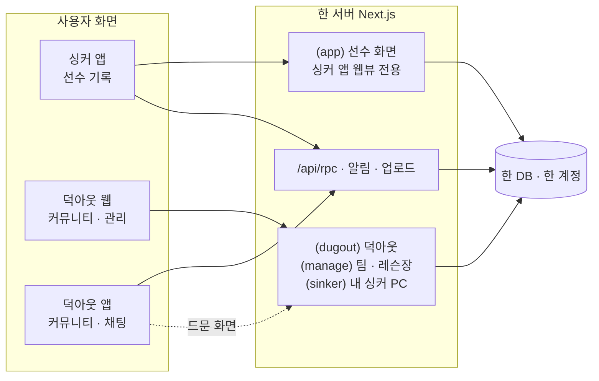

# 싱커 · 덕아웃 개편 계획

2026-10-21 금윤호 지시. 한 서버 · 한 계정 · 세 얼굴.

> "투구 · 타격 종합관리 시스템은 싱커, 각각 별개의 앱, 사이트는 덕아웃만. 덕아웃은 야구 통합 커뮤니티 시스템.
> 모두 동일한 서버 시스템 내에서 돌아가지만 웹에서는 덕아웃으로 통일하여 싱커의 선수 데이터 관리나 팀 관리를 더 편하게,
> 싱커는 선수용 앱으로 직접 기록 · 사용에 초점(지금 불펜로그가 이름만 싱커로, 기능은 동일). 별도의 덕아웃 앱은 커뮤니티 기능."

---

## 1. 세 얼굴

| | 싱커 앱 | 덕아웃 웹 | 덕아웃 앱 |
|---|---|---|---|
| 누가 | 선수 | 누구나(로그아웃도) · 선수 · 코치 · 팀 · 레슨장 · 학부모 | 누구나(로그인) |
| 무엇을 | 기록하고 본다 — 투구 · 타격 · 체크인 · 구속 측정 · 트레이닝 · 영양 · 영상 | 커뮤니티 · 장터 · 레슨 · 연습장 · 장비 + **큰 화면으로 싱커 자료 관리** + 팀 · 레슨장 관리 | 커뮤니티 · 장터 · 채팅 · 예약을 손안에서, 알림 |
| 지금 | `native/`(정식 '불펜로그' 앱) | `app/(dugout)` + `app/(master)` + PC 의 선수 화면 | 없음 |
| 바뀌는 것 | 이름 · 아이콘 · 시작 화면만. 기능 그대로 | 사이트 전체가 덕아웃 이름과 틀로 | 새로 만든다 |

**원칙**: 기록은 싱커에서, 관리는 덕아웃 웹에서, 사람과 거래는 덕아웃(웹 · 앱)에서.

## 2. 지금 구조에서 꼭 알아야 할 사실 셋

1. **싱커 앱은 화면 절반이 웹이다.** `native/src/app/index.tsx` 가 웹뷰로 사이트의 `app/(app)` 경로(/today · /videos · /hitting …)를 그린다.
   그래서 "웹은 덕아웃만"이어도 `(app)` 경로는 지우면 안 된다 — **싱커 앱이 쓰는 화면**으로 남고, 브라우저로 온 사람만 덕아웃 쪽으로 보낸다.
2. **계정은 이미 하나다.** 자체 세션(`lib/dal.ts readSession`) + `User` 표 하나. 앱 로그인도 같은 `auth.login`. '통합가입 · 연동'은 새 계정 시스템이 아니라
   **같은 계정을 어디서 썼는지 기록하고, 어디까지 보일지 정하는 일**이다.
3. **푸시 알림 표가 없다.** 앱이 둘이 되면 채팅은 덕아웃 앱으로, 기록 알림은 싱커로 — 어느 앱에 무엇을 보낼지가 처음 생기는 시스템이다.

## 3. 구조



서버가 지금 어느 얼굴인지 아는 곳은 하나로 모은다: `lib/app-env.ts` 에 `surfaceOf(userAgent) → 'sinker-app' | 'dugout-app' | 'web'`.
메뉴 · 알림 · 리디렉션은 이것만 본다(지금은 `expoLevel` · `isPhoneBrowser` 가 흩어져 있다).

## 4. 이름 바꾸기 — 바꾸는 것 · 안 바꾸는 것

| 바꾼다 | 안 바꾼다(이유) |
|---|---|
| 앱 표시 이름 'Bullpen Log' → **싱커**, App Store 이름 · 부제 · 아이콘 · 시작 화면 | **번들 ID `com.bullpenlog.app`** — 바꾸면 다른 앱이 되어 사용자가 다시 받아야 하고 TestFlight · 리뷰가 끊긴다 |
| 사이트 제목 · manifest · 홈 화면 아이콘 · OG 이미지 → **덕아웃** | 저장소 · 폴더 · DB 이름(`bullpen-log`) — 사용자에게 안 보이고, 바꾸는 비용만 크다 |
| 화면 문구 '불펜로그' 43곳(27파일) → 자리에 따라 싱커 / 덕아웃 | 앱 UA `BullpenLogApp` · `BullpenNative/N` — 서버 판별이 이것을 본다. 새 앱만 `DugoutApp/1` 을 단다 |
| 딥링크: `sinker://` 를 더한다 | `bullpenlog://` — 이미 나간 링크 · 옛 앱이 쓴다. 둘 다 받는다 |
| 약관 · 개인정보 처리방침의 서비스 이름(운영자 같음, 두 서비스) | 옛 주소 `bullpen-log.vercel.app` — 옛 앱 판의 `SITE_URL` 이라 계속 살아 있어야 한다(새 도메인으로 301 은 브라우저만) |
| 연락처 메일 표기(새 메일을 만들면) | |

## 5. 덕아웃 웹 화면

### 5-1. 틀 하나

지금은 선수 틀(`(app)`, 하단 탭 · 도크) · 마스터 틀(`(master)`) · 덕아웃 틀(`(dugout)`)이 따로 논다. PC 브라우저에서는 **덕아웃 틀 하나**로 합친다.

```
┌──────────────────────────────────────────────────────────────────────────────┐
│ 덕아웃   홈  커뮤니티  장터  레슨  연습장  장비        [검색]  채팅● 알림  [내 싱커] [관리] 나 ▾ │
└──────────────────────────────────────────────────────────────────────────────┘
```

- **내 싱커**: 싱커로 기록한 적이 있는 사람에게만 보인다. 아니면 '싱커 시작하기'(앱 받기 안내).
- **관리**: 팀 · 레슨장 계정(지금 마스터)에게만. 관리자(운영)는 '나 ▾' 안에 '운영'.
- 휴대폰 브라우저: 덕아웃은 그대로 열린다(지금 proxy OPEN). '내 싱커' · '관리'는 "싱커 앱에서 · PC 에서" 안내.

### 5-2. 화면 목록

| 영역 | 주소(제안) | 화면 | 지금 있나 |
|---|---|---|---|
| 덕아웃 | `/` | 홈 — 로그아웃: 지금 덕아웃 홈. 로그인: 위에 **내 싱커 요약 줄**(오늘 체크인 · 이번 주 투구 수 · 팔 상태) | 홈 있음, 요약 줄 새로 |
| | `/community` · `/community/[id]` | 커뮤니티 피드 — 지금 글 목록을 덕아웃 틀로 옮기고 개편(4-1, 김민과) | 있음(선수 틀 안) |
| | `/market` · `/lessons` · `/venues` · `/gear` · `/chat` | 지금 `/dugout/*` 그대로, 주소만 뿌리로 | 있음 |
| | `/u/[nickname]` | **공개 프로필** — 닉네임 · 포지션 · 지역 · 올린 물건 · 글 · (켠 사람만) 싱커 기록 요약 | 새로 |
| | `/notifications` | 알림함 — 채팅 · 예약 · 댓글 · 팀 공지 | 새로 |
| 내 싱커 | `/sinker` | **대시보드(PC)** — 주간 투구량 · 구속 추세 · 통증 지도 · 체크인 · 다음 등판 | 새 틀, 자료 읽기는 있음 |
| | `/sinker/log` | **기록 표** — 날짜별 투구 기록 표로 보기 · 고치기 · 기간 거르기 · CSV 내보내기 | 새로(앱의 기록 달력과 같은 자료) |
| | `/sinker/videos` | 영상 보관함 — 큰 화면 두 영상 나란히 비교 | 있음(/videos 를 PC 틀로) |
| | `/sinker/reports` | 리포트 — 기간 보고서 · 보호자 링크 · 코치 공유 | 보호자 리포트 있음 |
| | `/sinker/sharing` | 연결 — 어느 팀 · 레슨장에 무엇을 보이는지(ShareConsent) · 싱커 앱 연결 상태 | 동의는 있음, 화면 새로 |
| 관리 | `/manage/*` | 지금 `/master/*` 그대로(선수 카드 · 달력 · 레슨 노트 · 수강권 · 예약 · 연습장 · 정산 · 공지) | 있음, 주소만 |
| 운영 | `/admin/*` | 그대로, 덕아웃 틀 | 있음 |

**선수 화면 경로(`/today` · `/videos` · `/hitting` · `/training` · `/nutrition` …)는 싱커 앱 전용**이 된다:
앱 UA 면 지금처럼 그리고, PC 브라우저면 맞는 `/sinker/*` 로 보낸다(예: `/videos` → `/sinker/videos`, `/today` → `/sinker`).
처음 단계에서는 PC 브라우저도 지금 선수 화면을 덕아웃 틀 안에 그대로 보여 주고(빠르게 끝남), `/sinker` 전용 PC 화면은 하나씩 갈아 끼운다.

### 5-3. 내 싱커 대시보드(PC) 모양

```
┌ 내 싱커 ─────────────────────────────────────────────────────────────────┐
│ 대시보드 · 기록 표 · 영상 · 리포트 · 연결                       기간 [최근 4주 ▾] │
├──────────────┬──────────────┬──────────────┬──────────────────────────┤
│ 이번 주 투구 │ 최고 구속    │ 팔 상태      │ 다음 등판                │
│ 212개 ▲18%   │ 128 km/h     │ 좋음 (3일)   │ 10/24 (토) 연습 경기     │
├──────────────┴──────────────┴──────────────┴──────────────────────────┤
│ 주간 투구량 막대 + 급성:만성 비율 선                                     │
├───────────────────────────────────┬─────────────────────────────────────┤
│ 구속 추세(세션별 평균 · 최고)     │ 체크인(컨디션 · 수면 · 불편한 곳)  │
└───────────────────────────────────┴─────────────────────────────────────┘
```

자료는 이미 서버에 다 있다(`lib/org/player-data.ts` 가 코치 화면용으로 같은 것을 읽는다). 새로 만드는 것은 PC 배치뿐.

## 6. 싱커 앱

기능은 그대로. 바뀌는 것:

1. 이름 · 아이콘 · 시작 화면 · 로그인 화면 문구 → 싱커(바닥 코드라 **새로 굽기**, 김민).
2. **하단 탭의 '덕아웃'** — 덕아웃 앱이 나올 때까지는 그대로 둔다(지금 웹 판). 덕아웃 앱이 나오면 탭에서 빼고 더보기의 '덕아웃 열기'(앱이 있으면 앱, 없으면 스토어)로.
3. 더보기에 '**PC 에서 관리하기**' — 덕아웃 주소 + QR 로그인 안내.
4. 팀 · 레슨장 초대 수락 · 공유 동의는 앱에서도 그대로(지금 있음).

## 7. 덕아웃 앱(새로)

- **기술**: 같은 저장소에 두 번째 Expo 앱 `native-dugout/`. 서버 RPC(`/api/rpc`) · 로그인(`auth.login`) · 업로드(`/api/market/upload-url`)를 그대로 쓴다.
  싱커의 `lib/rpc.ts` · `lib/site.ts` · 로그인 화면 · 디자인 토큰은 처음엔 복사, 두 앱에서 굳으면 공용 폴더로 뺀다.
  번들 ID 는 새로(예: `com.bullpenlog.dugout` — 사용자에게 안 보인다). UA `DugoutApp/1`.
- **탭**: 홈 · 커뮤니티 · 장터 · 채팅 · 나. 레슨 · 연습장 · 장비는 홈 카드에서.
- **1판 범위**: 로그인 · 가입 · 피드 읽기 · 쓰기 · 장터 보기 · 올리기(카메라) · 채팅(푸시) · 레슨 · 연습장 예약 · 내 정보. 결제는 껍데기 그대로(웹뷰).
- **앱 화면 vs 웹뷰**: 자주 쓰는 넷(피드 · 장터 목록 · 상세 · 채팅)은 앱 화면, 나머지(장비 · 결제 · 약관)는 웹뷰로 시작.

## 8. 새로 더하는 시스템

| # | 시스템 | 무엇 | DB |
|---|---|---|---|
| A | 얼굴 판별 | `surfaceOf()` 하나로 싱커 앱 · 덕아웃 앱 · 웹 구분, 메뉴 · 리디렉션 · 알림이 이것만 본다 | 없음 |
| B | 가입 출처 · 회원 종류 | 덕아웃으로만 가입한 학부모 · 팬 · 코치도 받는다. 싱커에서 첫 기록을 하면 선수가 된다 | `User.signupSource`(SINKER · DUGOUT_WEB · DUGOUT_APP) · `User.sinkerStartedAt` · `AccountType` 에 `MEMBER` 더함 |
| C | 공개 범위 | 덕아웃 프로필에 싱커 기록을 어디까지 보일지 — 기본은 전부 숨김, 항목별 켜기(포지션 · 최고 구속 · 기록 일수) | `User.publicSinker Json` 또는 작은 표 |
| D | 알림 | 앱 기기 등록 + 알림 기록 + 보낼 곳 규칙(채팅 · 장터 · 예약 · 댓글 → 덕아웃 앱, 기록 · 트레이닝 · 팀 과제 → 싱커, 덕아웃 앱이 없으면 싱커가 대신) · 웹 알림함 | `PushDevice{userId, app, platform, token, lastSeenAt}` · `Notification{userId, kind, title, body, link, readAt}` |
| E | QR 로그인 | PC 덕아웃에 QR → 싱커 · 덕아웃 앱으로 찍으면 PC 가 로그인(반대로 앱 받기 링크도) | `LoginTicket{code, userId?, expiresAt}`(2분) |
| F | 앱 사이 이동 | `sinker://` · `dugout://` + 유니버설 링크(apple-app-site-association 에 두 앱 경로 나눔), '싱커에서 열기' 단추 | 없음 |
| G | 브랜드 토큰 | 같은 부품, 얼굴마다 색 · 로고 — `html[data-brand="dugout"\|"sinker"]` | 없음 |
| H | 도메인 · 경로 | 새 도메인, `/dugout/*` → 뿌리, `/master/*` → `/manage/*` 301, 옛 vercel 주소는 앱용으로 유지 | 없음 |
| I | 검색 노출 | 덕아웃 공개 화면 sitemap · OG 이미지 · 물건 · 레슨장 구조화 자료 | 없음 |

마이그레이션은 모두 **더하기만**(B · C · D · E), 지금 규칙대로 손으로 쓴 SQL.

## 9. 단계

시간은 Claude 작업 시간. 사용자 몫은 따로.

| 단계 | 내용 | Claude | 사용자 몫 |
|---|---|---|---|
| 0 준비 | 상표 확인(싱커 · 덕아웃), 도메인 고르기 · 사기, 로고 둘, App Store 새 이름 · 부제 | — | 전부 |
| 1 이름 | 웹 문구 · 메타 · manifest · 약관 서비스 이름 → 덕아웃, 앱 문구 → 싱커, `surfaceOf()`(A), 브랜드 토큰(G) | 2~3시간 | 로고 파일 |
| 2 웹 틀 | PC 브라우저를 덕아웃 틀 하나로, `/master` → `/manage`, 선수 화면을 덕아웃 틀 안에(우선 그대로), 로그인 홈 요약 줄 | 4~5시간 | 화면 보고 고칠 점 |
| 3 계정 | B · C, 덕아웃 가입 흐름(MEMBER), 싱커 첫 기록 온보딩, 공개 프로필 `/u/[nickname]` | 3~4시간 | — |
| 4 내 싱커 PC | `/sinker` 대시보드 · 기록 표 · 영상 · 리포트 · 연결 | 6~8시간 | — |
| 5 알림 | D 표 · 웹 알림함 · 보낼 곳 규칙 · 싱커 앱 푸시(expo-notifications, 굽기) | 웹 3시간 + 앱(김민) | APNs 키 |
| 6 덕아웃 앱 1판 | 7절 범위 | 2~3일 | 앱 등록 · 스크린샷 · 심사 |
| 7 도메인 | H · I, QR 로그인(E), 앱 사이 링크(F) | 3시간 | DNS · Vercel 도메인 연결 |

1 → 2 → 3 은 차례대로, 4 · 5 는 3 뒤 같이, 6 은 5 뒤(채팅 푸시가 덕아웃 앱의 핵심), 7 은 아무 때나 도메인이 생기면.

## 10. 나눌 일(제안)

- 금윤호(웹): 1 · 2 · 3 · 4 · 5 웹 · 7.
- 김민(앱): 싱커 이름 · 아이콘 · 굽기, 5 앱 푸시, 6 덕아웃 앱(김민 영역 규칙 — `native/` 는 김민).
- 커뮤니티 피드 개편(4-1)은 김민이 '커뮤니티 개선'을 맡겠다고 했던 자리 — 덕아웃 틀로 옮길 때 한 사람이 맡는다.

## 11. 위험

- **번들 ID** 를 바꾸면 사용자가 앱을 다시 받아야 한다 → 안 바꾼다.
- **`(app)` 경로를 지우면 싱커 앱이 깨진다** → 브라우저만 보내고, 앱 UA 는 그대로 그린다. 시험 하나 더한다(앱 UA 로 선수 경로가 200).
- **옛 앱 판은 vercel 주소를 본다** → 그 주소는 계속 산다. 새 판(OTA)부터 새 도메인.
- **'싱커'는 구종 이름이라 검색에 묻힌다** → App Store 이름에 부제(예: '싱커 — 투수 · 타자 기록').
- **기존 사용자 혼란** → 앱 안 공지 + 패치노트 + 로그인 화면에 "불펜로그가 싱커로" 한 달.
- **장터는 통신판매중개** → 결제를 열기 전에 고지 · 사업자 요건 확인(사용자 · 법률).

## 12. 정해 줄 것

1. 싱커 하단 탭의 '덕아웃' — 덕아웃 앱이 나올 때까지 둔다(추천) / 지금 뺀다.
2. PC 에서 선수의 새 기록 입력 — 보기 · 고치기 · 내보내기만, 새 기록은 앱(추천) / PC 에서도 입력.
3. 덕아웃만 쓰는 회원(학부모 · 팬 · 코치) — 받는다(추천) / 선수 · 관리 계정만.
4. 덕아웃 앱 — 같은 저장소의 두 번째 Expo 앱(추천) / 싱커 앱 하나에 두 얼굴.
5. 주소 — 새 도메인에서 경로를 뿌리로(`/market`, 추천) / 지금처럼 `/dugout/*`.
