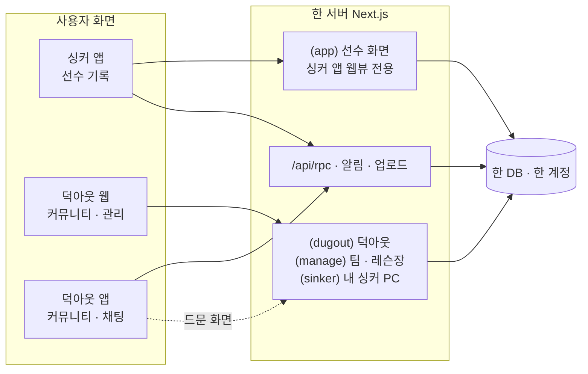

# 싱커 · 덕아웃 개편 계획

2026-10-21 금윤호 지시. 한 서버 · 한 계정 · 세 얼굴.

> "투구 · 타격 종합관리 시스템은 싱커, 각각 별개의 앱, 사이트는 덕아웃만. 덕아웃은 야구 통합 커뮤니티 시스템.
> 모두 동일한 서버 시스템 내에서 돌아가지만 웹에서는 덕아웃으로 통일하여 싱커의 선수 데이터 관리나 팀 관리를 더 편하게,
> 싱커는 선수용 앱으로 직접 기록 · 사용에 초점(지금 불펜로그가 이름만 싱커로, 기능은 동일). 별도의 덕아웃 앱은 커뮤니티 기능."

---

## 1. 세 얼굴

| | 싱커 앱 | 덕아웃 웹 | 덕아웃 앱 |
|---|---|---|---|
| 누가 | 선수 | 누구나(로그아웃도) · 선수 · 코치 · 팀 · 레슨장 · 학부모 | 누구나(로그인) |
| 무엇을 | 기록하고 본다 — 투구 · 타격 · 체크인 · 구속 측정 · 트레이닝 · 영양 · 영상 | 커뮤니티 · 장터 · 레슨 · 연습장 · 장비 + **큰 화면으로 싱커 자료 관리** + 팀 · 레슨장 관리 | 커뮤니티 · 장터 · 채팅 · 예약을 손안에서, 알림 |
| 지금 | `native/`(정식 '불펜로그' 앱) | `app/(dugout)` + `app/(master)` + PC 의 선수 화면 | 없음 |
| 바뀌는 것 | 이름 · 아이콘 · 시작 화면만. 기능 그대로 | 사이트 전체가 덕아웃 이름과 틀로 | 새로 만든다 |

**원칙**: 기록은 싱커에서, 관리는 덕아웃 웹에서, 사람과 거래는 덕아웃(웹 · 앱)에서.

## 2. 지금 구조에서 꼭 알아야 할 사실 셋

1. **싱커 앱은 화면 절반이 웹이다.** `native/src/app/index.tsx` 가 웹뷰로 사이트의 `app/(app)` 경로(/today · /videos · /hitting …)를 그린다.
   그래서 "웹은 덕아웃만"이어도 `(app)` 경로는 지우면 안 된다 — **싱커 앱이 쓰는 화면**으로 남고, 브라우저로 온 사람만 덕아웃 쪽으로 보낸다.
2. **계정은 이미 하나다.** 자체 세션(`lib/dal.ts readSession`) + `User` 표 하나. 앱 로그인도 같은 `auth.login`. '통합가입 · 연동'은 새 계정 시스템이 아니라
   **같은 계정을 어디서 썼는지 기록하고, 어디까지 보일지 정하는 일**이다.
3. **푸시 알림 표가 없다.** 앱이 둘이 되면 채팅은 덕아웃 앱으로, 기록 알림은 싱커로 — 어느 앱에 무엇을 보낼지가 처음 생기는 시스템이다.

## 3. 구조



서버가 지금 어느 얼굴인지 아는 곳은 하나로 모은다: `lib/app-env.ts` 에 `surfaceOf(userAgent) → 'sinker-app' | 'dugout-app' | 'web'`.
메뉴 · 알림 · 리디렉션은 이것만 본다(지금은 `expoLevel` · `isPhoneBrowser` 가 흩어져 있다).

## 4. 이름 바꾸기 — 바꾸는 것 · 안 바꾸는 것

| 바꾼다 | 안 바꾼다(이유) |
|---|---|
| 앱 표시 이름 'Bullpen Log' → **싱커**, App Store 이름 · 부제 · 아이콘 · 시작 화면 | **번들 ID `com.bullpenlog.app`** — 바꾸면 다른 앱이 되어 사용자가 다시 받아야 하고 TestFlight · 리뷰가 끊긴다 |
| 사이트 제목 · manifest · 홈 화면 아이콘 · OG 이미지 → **덕아웃** | 저장소 · 폴더 · DB 이름(`bullpen-log`) — 사용자에게 안 보이고, 바꾸는 비용만 크다 |
| 화면 문구 '불펜로그' 43곳(27파일) → 자리에 따라 싱커 / 덕아웃 | 앱 UA `BullpenLogApp` · `BullpenNative/N` — 서버 판별이 이것을 본다. 새 앱만 `DugoutApp/1` 을 단다 |
| 딥링크: `sinker://` 를 더한다 | `bullpenlog://` — 이미 나간 링크 · 옛 앱이 쓴다. 둘 다 받는다 |
| 약관 · 개인정보 처리방침의 서비스 이름(운영자 같음, 두 서비스) | 옛 주소 `bullpen-log.vercel.app` — 옛 앱 판의 `SITE_URL` 이라 계속 살아 있어야 한다(새 도메인으로 301 은 브라우저만) |
| 연락처 메일 표기(새 메일을 만들면) | |

## 5. 덕아웃 웹 화면

### 5-1. 틀 하나

지금은 선수 틀(`(app)`, 하단 탭 · 도크) · 마스터 틀(`(master)`) · 덕아웃 틀(`(dugout)`)이 따로 논다. PC 브라우저에서는 **덕아웃 틀 하나**로 합친다.

```
┌──────────────────────────────────────────────────────────────────────────────┐
│ 덕아웃   홈  커뮤니티  장터  레슨  연습장  장비        [검색]  채팅● 알림  [내 싱커] [관리] 나 ▾ │
└──────────────────────────────────────────────────────────────────────────────┘
```

- **내 싱커**: 싱커로 기록한 적이 있는 사람에게만 보인다. 아니면 '싱커 시작하기'(앱 받기 안내).
- **관리**: 팀 · 레슨장 계정(지금 마스터)에게만. 관리자(운영)는 '나 ▾' 안에 '운영'.
- 휴대폰 브라우저: 덕아웃은 그대로 열린다(지금 proxy OPEN). '내 싱커' · '관리'는 "싱커 앱에서 · PC 에서" 안내.

### 5-2. 화면 목록

| 영역 | 주소(제안) | 화면 | 지금 있나 |
|---|---|---|---|
| 덕아웃 | `/` | 홈 — 로그아웃: 지금 덕아웃 홈. 로그인: 위에 **내 싱커 요약 줄**(오늘 체크인 · 이번 주 투구 수 · 팔 상태) | 홈 있음, 요약 줄 새로 |
| | `/community` · `/community/[id]` | 커뮤니티 피드 — 지금 글 목록을 덕아웃 틀로 옮기고 개편(4-1, 김민과) | 있음(선수 틀 안) |
| | `/market` · `/lessons` · `/venues` · `/gear` · `/chat` | 지금 `/dugout/*` 그대로, 주소만 뿌리로 | 있음 |
| | `/u/[nickname]` | **공개 프로필** — 닉네임 · 포지션 · 지역 · 올린 물건 · 글 · (켠 사람만) 싱커 기록 요약 | 새로 |
| | `/notifications` | 알림함 — 채팅 · 예약 · 댓글 · 팀 공지 | 새로 |
| 내 싱커 | `/sinker` | **대시보드(PC)** — 주간 투구량 · 구속 추세 · 통증 지도 · 체크인 · 다음 등판 | 새 틀, 자료 읽기는 있음 |
| | `/sinker/log` | **기록 표** — 날짜별 투구 기록 표로 보기 · 고치기 · 기간 거르기 · CSV 내보내기 | 새로(앱의 기록 달력과 같은 자료) |
| | `/sinker/videos` | 영상 보관함 — 큰 화면 두 영상 나란히 비교 | 있음(/videos 를 PC 틀로) |
| | `/sinker/reports` | 리포트 — 기간 보고서 · 보호자 링크 · 코치 공유 | 보호자 리포트 있음 |
| | `/sinker/sharing` | 연결 — 어느 팀 · 레슨장에 무엇을 보이는지(ShareConsent) · 싱커 앱 연결 상태 | 동의는 있음, 화면 새로 |
| 관리 | `/manage/*` | 지금 `/master/*` 그대로(선수 카드 · 달력 · 레슨 노트 · 수강권 · 예약 · 연습장 · 정산 · 공지) | 있음, 주소만 |
| 운영 | `/admin/*` | 그대로, 덕아웃 틀 | 있음 |

**PC 에서도 싱커의 모든 기능을 쓴다(결정 2)** — 기록 입력 · 고치기 · 트레이닝 추천 · 영양 · 영상 전부. 빠지는 것은 **측정**(구속 측정 · ABS · 촬영 모드 · 3D 촬영)뿐 —
PC 의 '내 싱커'에서는 그 자리에 "싱커 앱에서 재요" 카드만 둔다. 선수 화면 경로(`/today` · `/videos` …)는 지금처럼 앱 · PC 모두 그리되, PC 브라우저에서는 덕아웃 틀(위 막대) 안에 들어간다.
`/sinker` 는 PC 전용 **대시보드**(첫 화면)이고, 나머지 `/sinker/*` 는 지금 선수 화면의 PC 배치판이다.

### 5-3. 내 싱커 대시보드(PC) 모양

```
┌ 내 싱커 ─────────────────────────────────────────────────────────────────┐
│ 대시보드 · 기록 표 · 영상 · 리포트 · 연결                       기간 [최근 4주 ▾] │
├──────────────┬──────────────┬──────────────┬──────────────────────────┤
│ 이번 주 투구 │ 최고 구속    │ 팔 상태      │ 다음 등판                │
│ 212개 ▲18%   │ 128 km/h     │ 좋음 (3일)   │ 10/24 (토) 연습 경기     │
├──────────────┴──────────────┴──────────────┴──────────────────────────┤
│ 주간 투구량 막대 + 급성:만성 비율 선                                     │
├───────────────────────────────────┬─────────────────────────────────────┤
│ 구속 추세(세션별 평균 · 최고)     │ 체크인(컨디션 · 수면 · 불편한 곳)  │
└───────────────────────────────────┴─────────────────────────────────────┘
```

자료는 이미 서버에 다 있다(`lib/org/player-data.ts` 가 코치 화면용으로 같은 것을 읽는다). 새로 만드는 것은 PC 배치뿐.

## 6. 싱커 앱

기능은 그대로. 바뀌는 것:

1. 이름 · 아이콘 · 시작 화면 · 로그인 화면 문구 → 싱커(바닥 코드라 **새로 굽기**, 김민).
2. **하단 탭의 '덕아웃'은 영구(결정 1)** — 싱커 안에서 덕아웃 전부(커뮤니티 · 장터 · 채팅 · 레슨 · 연습장 · 장비 · 결제)를 쓴다. 지금처럼 웹 판(웹뷰)으로 그리되,
   채팅 · 장터 알림은 싱커로도 온다. 덕아웃 앱은 **선수가 아닌 사람**(학부모 · 팬 · 코치 · 구매자)의 얼굴이다 — 선수는 싱커 하나면 된다.
3. 더보기에 '**PC 에서 관리하기**' — 덕아웃 주소 + QR 로그인 안내.
4. 팀 · 레슨장 초대 수락 · 공유 동의는 앱에서도 그대로(지금 있음).

## 7. 덕아웃 앱(새로)

- **기술**: 같은 저장소에 두 번째 Expo 앱 `native-dugout/`. 서버 RPC(`/api/rpc`) · 로그인(`auth.login`) · 업로드(`/api/market/upload-url`)를 그대로 쓴다.
  싱커의 `lib/rpc.ts` · `lib/site.ts` · 로그인 화면 · 디자인 토큰은 처음엔 복사, 두 앱에서 굳으면 공용 폴더로 뺀다.
  번들 ID 는 새로(예: `com.bullpenlog.dugout` — 사용자에게 안 보인다). UA `DugoutApp/1`.
- **탭**: 홈 · 커뮤니티 · 장터 · 채팅 · 나. 레슨 · 연습장 · 장비는 홈 카드에서.
- **1판 범위**: 로그인 · 가입 · 피드 읽기 · 쓰기 · 장터 보기 · 올리기(카메라) · 채팅(푸시) · 레슨 · 연습장 예약 · 내 정보. 결제는 껍데기 그대로(웹뷰).
- **앱 화면 vs 웹뷰**: 자주 쓰는 넷(피드 · 장터 목록 · 상세 · 채팅)은 앱 화면, 나머지(장비 · 결제 · 약관)는 웹뷰로 시작.

## 8. 새로 더하는 시스템

| # | 시스템 | 무엇 | DB |
|---|---|---|---|
| A | 얼굴 판별 | `surfaceOf()` 하나로 싱커 앱 · 덕아웃 앱 · 웹 구분, 메뉴 · 리디렉션 · 알림이 이것만 본다 | 없음 |
| B | 가입 출처 · 회원 종류 | 덕아웃으로만 가입한 학부모 · 팬 · 코치도 받는다. 싱커에서 첫 기록을 하면 선수가 된다 | `User.signupSource`(SINKER · DUGOUT_WEB · DUGOUT_APP) · `User.sinkerStartedAt` · `AccountType` 에 `MEMBER` 더함 |
| C | 공개 범위 | 덕아웃 프로필에 싱커 기록을 어디까지 보일지 — 기본은 전부 숨김, 항목별 켜기(포지션 · 최고 구속 · 기록 일수) | `User.publicSinker Json` 또는 작은 표 |
| D | 알림 | 앱 기기 등록 + 알림 기록 + 보낼 곳 규칙(채팅 · 장터 · 예약 · 댓글 → 덕아웃 앱, 기록 · 트레이닝 · 팀 과제 → 싱커, 덕아웃 앱이 없으면 싱커가 대신) · 웹 알림함 | `PushDevice{userId, app, platform, token, lastSeenAt}` · `Notification{userId, kind, title, body, link, readAt}` |
| E | QR 로그인 | PC 덕아웃에 QR → 싱커 · 덕아웃 앱으로 찍으면 PC 가 로그인(반대로 앱 받기 링크도) | `LoginTicket{code, userId?, expiresAt}`(2분) |
| F | 앱 사이 이동 | `sinker://` · `dugout://` + 유니버설 링크(apple-app-site-association 에 두 앱 경로 나눔), '싱커에서 열기' 단추 | 없음 |
| G | 브랜드 토큰 | 같은 부품, 얼굴마다 색 · 로고 — `html[data-brand="dugout"\|"sinker"]` | 없음 |
| H | 도메인 · 경로 | 새 도메인, `/dugout/*` → 뿌리, `/master/*` → `/manage/*` 301, 옛 vercel 주소는 앱용으로 유지 | 없음 |
| I | 검색 노출 | 덕아웃 공개 화면 sitemap · OG 이미지 · 물건 · 레슨장 구조화 자료 | 없음 |

마이그레이션은 모두 **더하기만**(B · C · D · E), 지금 규칙대로 손으로 쓴 SQL.

## 9. 결정(2026-10-21 금윤호)

| # | 물음 | 결정 | 계획에 미치는 것 |
|---|---|---|---|
| 1 | 싱커 안의 덕아웃 | **싱커에서 덕아웃 기능 전부 쓴다** | 하단 탭 '덕아웃' 영구. 덕아웃 앱은 선수가 아닌 사람용. 알림은 싱커로도 |
| 2 | PC 의 싱커 | **전부 가능, 측정(구속 · ABS · 촬영)만 빼고** — 트레이닝 추천 · 기록 확인이 메인 | `/sinker` 대시보드 + 지금 선수 화면을 덕아웃 틀 안에. 측정 자리는 "앱에서" 카드 |
| 3 | 덕아웃만 쓰는 회원 | **통합 계정** — 덕아웃에서 레슨 예약 → 레슨 → 코치가 적으면 **선수 운동 기록에 저절로** | 레슨 노트 → 선수 기록 연결(아래 3-x). 회원 종류 `MEMBER` |
| 4 | 덕아웃 앱 | 같은 저장소의 두 번째 Expo 앱 | 7절 그대로 |
| 5 | 주소 | 새 도메인에서 뿌리 경로(`/market`) | 8절 H 그대로 |

### 결정 3 — 레슨이 기록이 되는 길

지금 있는 것: 예약 확정 → `OrgMember` + `OrgEvent(lesson)` 자동(2판), 코치의 **레슨 노트**(`LessonNote` — 날짜 · 내용 · 숙제), 코치의 **대신 기록**(`createPitchLogs` — 투구 기록을 선수 이름으로).
없는 것: 레슨 노트가 선수 쪽 화면 · 기록에 안 나타난다. 그래서:

1. `LessonNote` 에 **구조 칸**을 더한다 — `exercises Json?`(한 운동 · 세트 · 횟수 · 무게 · 메모), `pitchCount Int?`, `intensity Int?`(1~10). 코치 노트 화면에 '한 일' 표 입력.
2. 레슨 노트를 저장하면 선수의 **기록 달력 · 홈 · 트레이닝 탭**에 '레슨' 줄로 보인다(싱커 앱 · PC 둘 다) — 읽기 함수 하나(`lib/org/lesson-feed.ts`), 선수에게 알림.
3. 트레이닝 추천 엔진이 레슨의 '한 일'을 **그날 운동량**으로 센다(피로 · 급성:만성 계산) — 김민 영역(`lib/training-*`)이라 **읽기 함수 이름과 모양을 김민과 맞춘 뒤** 잇는다.
4. 덕아웃만 쓰던 회원이 레슨을 받으면 그 순간 **싱커 계정이 된다**(`sinkerStartedAt`) — 덕아웃 홈에 '내 싱커' 줄이 생기고 "싱커 앱에서 더 보기" 안내.

## 10. 파트

| 파트 | 맡는 사람 | 범위 |
|---|---|---|
| **A 웹** | 금윤호(Claude) | 이름 · 덕아웃 틀 · 계정 · 내 싱커 PC · 레슨→기록 · 알림 서버 · 도메인 |
| **B 앱** | 김민(Claude) | 싱커 이름 · 아이콘 · 굽기, 앱 푸시 받기, 덕아웃 앱, 트레이닝 엔진이 레슨 운동량 읽기 |
| **C 사람** | 금윤호(사용자) | 상표 · 도메인 · 로고 · App Store · APNs 키 · 김민과 나눌 일 확정 |

## 11. 세분화 단계 — A 웹

시간은 Claude 작업 시간. ☐ 로 진행 표시. **단계마다 커밋 + 메모, 끝나면 "다음 할까요" 묻기.**

### 1단계 이름 (2~3시간) — 끝(2026-10-21, 로컬 커밋)
- ☑ 1-1 `lib/brand.ts` — 이름 상수(`SINKER` · `DUGOUT`), 얼굴마다 문구. `surfaceOf(ua)`(`lib/app-env.ts`) 하나로 싱커 앱 · 덕아웃 앱 · 웹 판별.
- ☑ 1-2 웹 문구 '불펜로그' 43곳 → 자리에 따라 덕아웃 / 싱커. 사이트 제목 · manifest · OG · 로그인 화면 · 약관 서비스 이름.
- ☑ 1-3 브랜드 토큰 `html[data-brand]` — 덕아웃 색 · 싱커 색, 로고 자리(글자 로고로 시작, 파일 오면 교체).
- ☑ 1-4 '불펜로그가 싱커 · 덕아웃으로' 공지 한 줄(로그인 화면 · 앱 홈 · 패치노트).
- 답(10-21): 로고는 임시로 Claude 가(파일은 나중에), 색은 베타로 덕아웃 초록 · 싱커 파랑, 도메인은 이름 그대로(덕아웃).
- 남긴 것: 웹 시작 연출(components/app-splash.tsx)과 PWA 아이콘은 아직 옛 B — 로고 파일이 오면 같이 바꾼다. 앱 안 문구(native/)는 B-1(김민).

### 2단계 덕아웃 틀 (4~5시간) — 끝(2026-10-21, 로컬 커밋)
- ☑ 2-1 `components/dugout/dugout-shell.tsx` 를 사이트 공용 위 막대로 — 홈 · 커뮤니티 · 장터 · 레슨 · 연습장 · 장비 · 검색 · 채팅 · 알림 · **내 싱커** · **관리** · 나.
- ☑ 2-2 PC 브라우저(`surfaceOf === 'web'` 이고 데스크톱)의 선수 화면 `(app)` 을 덕아웃 틀 안에 — 지금 도크 · PC 메뉴는 '내 싱커' 안의 왼쪽 메뉴로. 앱(싱커 웹뷰)은 그대로.
- ☑ 2-3 `/master/*` → `/manage/*`(301), 마스터 틀을 덕아웃 틀 안으로.
- ☑ 2-4 `/dugout/*` → 뿌리(`/market` …) — 주소 옮기기 + 옛 주소 301(도메인 전이라도 먼저 해 둠, `/community` 피드는 그대로).
- ☑ 2-5 로그인한 덕아웃 홈의 '내 싱커 요약 줄'.
- 한 것: 공용 위 막대 `components/dugout/dugout-topbar.tsx`(덕아웃 · PC 선수 화면 · 관리 셋 다), 내 싱커 요약 줄 `components/dugout/sinker-strip.tsx`, `/` = 덕아웃 홈(앱 안은 /today), 옛 `/dugout/*` · `/master/*` 는 next.config 301.
  PC 선수 화면의 도크 · 메뉴는 그대로 두고 위에 막대만 얹었다(4-3 에서 배치를 손본다). 커뮤니티 피드 개편 담당은 김민에게 물어 둠(HANDOFF).

### 3단계 계정 · 레슨→기록 (4~5시간) — 끝(2026-10-21, 마이그레이션 `20261021120000_sinker_dugout_account` 공유 DB 적용)
- ☑ 3-1 마이그레이션(더하기만): `User.signupSource` · `User.sinkerStartedAt` · `AccountType.MEMBER` · `LessonNote.exercises/pitchCount/intensity` · `User.publicSinker`.
- ☑ 3-2 덕아웃 가입(`/login?signup=1`) 에 '선수 · 학부모 · 코치 · 그냥 야구 팬' 고르기 → MEMBER 는 싱커 온보딩 생략.
- ☑ 3-3 코치 레슨 노트에 '한 일' 표 입력(운동 · 세트 · 횟수 · 투구 수 · 강도).
- ☑ 3-4 선수 쪽 레슨 줄 읽기(`lib/org/lesson-feed.ts`) → 기록 달력 · 홈 · 트레이닝 탭에 '레슨' 카드, 알림.
- ☑ 3-5 첫 레슨 기록이 생기면 `sinkerStartedAt` 찍고 덕아웃 홈에 '내 싱커' 줄 + 앱 안내.
- ☑ 3-6 공개 프로필 `/u/[nickname]` + 공개 범위 설정(기본 전부 숨김).
- 김민과: 3-4 의 운동량을 트레이닝 엔진이 읽는 함수 모양 — 준비해 둔 것: `lib/org/lesson-work.ts lessonLoadOf(exercises, pitchCount)` · `lib/org/lesson-feed.ts loadLessonFeed(userId)`. 3-4 의 알림은 5단계에서 잇는다.

### 4단계 내 싱커 PC (6~8시간) — 끝(2026-10-21, 로컬 커밋). 4-3 은 '덕아웃 틀 안에 그대로'까지 — 화면별 PC 배치 손질은 보고 고칠 점을 받은 뒤
- ☑ 4-1 `/sinker` 대시보드 — 지표 넷 · 주간 투구량 · 구속 추세 · 체크인 · **오늘의 트레이닝 추천 카드**(지금 엔진 결과 그대로).
- ☑ 4-2 `/sinker/log` 기록 표 — 기간 · 종류 거르기, 줄에서 바로 고치기, CSV.
- ☑ 4-3 지금 선수 화면들의 PC 배치 손보기(투구 기록 · 타격 · 트레이닝 · 영양 · 영상) — 2단계에서 틀 안에 넣은 것을 넓은 화면에 맞게.
- ☑ 4-4 측정 자리(구속 측정 · ABS · 촬영 · 3D 촬영)는 PC 에서 "싱커 앱에서 재요" 카드 + QR.
- ☑ 4-5 `/sinker/sharing` 연결 — 팀 · 레슨장별 공유 범위, 앱 연결 상태.

### 5단계 알림 (웹 3시간) — 웹 끝(2026-10-21, 마이그레이션 `20261021150000_notifications` 공유 DB 적용). 앱 쪽(B-4)은 김민
- ☑ 5-1 마이그레이션: `PushDevice` · `Notification`.
- ☑ 5-2 `lib/notify.ts` — 종류 · 보낼 곳 규칙(채팅 · 장터 · 예약 · 댓글 · 레슨 기록 · 팀 공지), 웹 알림함 `/notifications` + 위 막대 숫자.
- ☑ 5-3 보내기: Expo push API(싱커 · 덕아웃 앱 공용), 기기 등록 RPC(`push.register`).
- 김민: 앱에서 토큰 등록 · 받기(expo-notifications, 굽기) — RPC `push.registerPushDevice({ token, app: 'sinker' | 'dugout', platform })` · `push.unregisterPushDevice({ token })`. 보내기는 Expo push API(exp.host) 라 APNs 키는 Expo 쪽 설정(사용자 · 김민).
- 보내는 곳(지금): 채팅 · 레슨 예약 요청/확정/거절 · 연습장 요청/답 · 코치 레슨 노트. 댓글 · 팀 공지는 김민의 커뮤니티 · 팀 화면 쪽에서 `notify()` 한 줄씩.

### 7단계 도메인 (3시간) — 도메인이 생기면
- ☐ 7-1 Vercel 도메인 연결 · 옛 주소는 유지(앱용) · 브라우저만 301.
- ☐ 7-2 sitemap · OG 이미지 · 구조화 자료.
- ☐ 7-3 QR 로그인(`LoginTicket`) · `sinker://` · `dugout://` · 유니버설 링크.

## 12. 세분화 단계 — B 앱(김민에게 넘길 것)

- ☐ B-1 싱커 이름 · 아이콘 · 시작 화면 · 로그인 문구(바닥 코드 → 굽기). 번들 ID 그대로.
- ☐ B-2 하단 탭 '덕아웃' 유지, 더보기에 'PC 에서 관리하기'.
- ☐ B-3 트레이닝 엔진이 레슨 '한 일'을 그날 운동량으로 읽기(3-4 와 짝).
- ☐ B-4 푸시 받기(expo-notifications) · 토큰 등록(5-3 과 짝).
- ☐ B-5 덕아웃 앱 1판(`native-dugout/`) — 5단계 뒤.

## 13. 물어볼 것

사용자에게(1단계 전):
1. 로고 — 싱커 · 덕아웃 로고 파일이 있나, 없으면 글자 로고로 시작해도 되나.
2. 색 — 덕아웃(초록 계열) · 싱커(파랑 계열)로 제안해도 되나, 정해 둔 색이 있나.
3. 도메인 — 후보가 있나(7단계만 막힌다, 지금은 안 급함).

김민과 상의(사용자가 전해 주거나 HANDOFF):
4. 싱커 이름 바꾸기 · 굽기 일정(B-1). 번들 ID 는 안 바꾼다는 데 동의하는지.
5. 덕아웃 앱을 김민이 맡는지(B-5), 커뮤니티 피드 개편을 누가 맡는지.
6. 레슨 '한 일' → 트레이닝 엔진 읽기 함수 모양(B-3).
